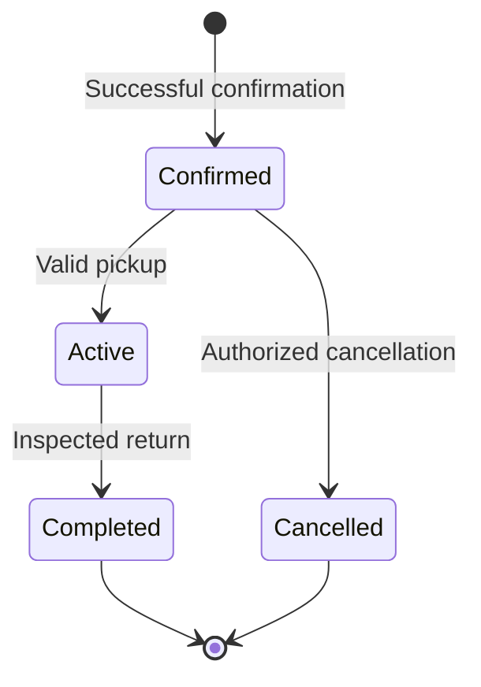

# DriveFleet Product Requirements Document

| Document field | Value |
| --- | --- |
| Product | DriveFleet - Car Rental & Fleet Management |
| Project | Capstone Project |
| Version | 1.0 |
| Date | 12 October 2026 |
| Status | Draft for implementation planning; business policy decisions remain open |
| Source | User-supplied `Pasted markdown.md`, reviewed in full |
| Intended readers | Product owner, designers, developers, testers, and capstone reviewers |
| Release scope | One rental company, configurable branches, three roles, 48 product route templates, and system screens |

## 1. Executive summary

DriveFleet is a responsive web application that brings customer car rental and internal fleet operations into one system. Customers find available vehicles, receive a clear quote, reserve a car through simulated checkout, and manage their rentals. Staff handle customer records, reservations, vehicle handovers, returns, condition, mileage, and maintenance. Admin/Managers manage the fleet, commercial rules, team permissions, business settings, and company-wide reporting.

The product serves a small-to-medium rental company that currently coordinates work through phone calls, paper records, and spreadsheets. Its central promise is a consistent record of which vehicle is available, to whom it is reserved, what the rental costs, and what operational work is required.

The first release is a complete capstone application with persisted records and a shareable deployment. A browser-storage prototype may support design review, but it does not satisfy full-stack release requirements. Checkout is explicitly simulated; displayed financial figures are rental values and demo results, not proof of money collected.

### 1.1 Basis and interpretation

The attached build specification is the scope baseline. This PRD reorganizes it into product requirements and acceptance criteria without claiming that any functionality has already been implemented.

- **Source requirement:** behavior, routes, and defaults explicitly specified in the attachment.
- **PRD clarification:** an operational definition or acceptance criterion added to make the source testable.
- **Proposed policy/target:** a suggested default or quality target that the source does not specify. These are labeled and listed in Section 15 for review.

DriveFleet is an editable working brand. Lagos/Abuja branches, NGN pricing, fictional records, and demo discounts are source defaults rather than verified market prices or established company policies.

## 2. Problem and opportunity

| Current problem | Impact | Required product response |
| --- | --- | --- |
| Reservations are coordinated manually | Multiple customers can be promised the same vehicle | Shared availability logic and atomic conflict prevention |
| Fleet status is scattered across records | Staff cannot confidently identify rentable vehicles | A fleet register, reservation calendar, and operational-state history |
| Prices are calculated manually | Inconsistent quotes and hidden calculation differences | One explainable pricing engine for all booking channels |
| Customers must call for basic tasks | Slow booking and unnecessary staff workload | Self-service browsing, reservation, and booking management |
| Condition, mileage, and service records are disconnected | Missed maintenance and unreliable return inspections | Recorded pickup/return inspections and maintenance milestones |
| Reports depend on spreadsheets | Limited visibility into fleet performance and rental value | Analytics calculated from the same operational records |

No baseline booking volume, conflict rate, conversion rate, or utilization level is provided. Improvement claims must wait for measured use.

## 3. Goals, scope, and success measures

### 3.1 Product goals

1. Let a customer complete a rental reservation from vehicle search through confirmation and account visibility.
2. Give staff one place to manage reservations, customers, vehicle handovers, returns, and maintenance.
3. Prevent confirmed overlapping reservations across customer and staff booking channels.
4. Produce consistent, itemized quotes using base rates, weekend rules, date overrides, duration discounts, and promo codes.
5. Preserve vehicle condition and odometer history across the rental lifecycle.
6. Give managers accurate, permission-controlled views of booked value, completed rental charges, utilization, and customer activity.
7. Deliver every specified page in a responsive, authenticated, persisted application suitable for capstone review.

### 3.2 In scope for version 1

- Branded public website, vehicle discovery, date-based availability, and vehicle details.
- Customer signup, sign-in, email verification, password reset, account profile, and booking history.
- Staff/admin authentication and role enforcement at route, API, database, and attachment boundaries.
- Customer and staff-assisted reservations, amendments, cancellations, and simulated checkout.
- Fleet creation, reading, editing, and controlled archival as the history-preserving deletion behavior.
- Customer CRM records, internal notes, and links to authenticated customer accounts where appropriate.
- Pickup/return inspections, condition attachments, mileage tracking, and operational status changes.
- Maintenance schedules, service thresholds, downtime blocks, and conflict resolution.
- Pricing rules, promo management, reports, CSV exports, printable/downloadable booking summaries.
- Team management, organization settings, alerts, audit history, seed data, and deployment documentation.
- All 48 route templates and shared system screens described in Section 7.

### 3.3 Out of scope for version 1

Real payment capture/refunds, card storage, a multi-company SaaS tenancy model, a rental marketplace, chauffeur dispatch, ride-hailing, recurring subscriptions, GPS/telematics, native mobile apps, and automated mileage capture are excluded. Business email/SMS booking campaigns and a signed digital-contract service are not required. Authentication verification/reset emails are still required for those auth flows.

### 3.4 Release measures and later product metrics

| Measure | Definition | Version 1 target |
| --- | --- | --- |
| Route completeness | Required product routes with working screens and specified actions | 48 of 48, plus all system screens |
| Reservation integrity | Conflicting confirmations accepted in controlled overlap/concurrency checks | Zero |
| Duplicate confirmation protection | Extra bookings created from repeated submission of one confirmation request | Zero |
| Authorization correctness | Disallowed reads/writes succeeding in the role and ownership test matrix | Zero |
| Quote consistency | Differences across customer, staff, checkout, and persisted quote for identical inputs | Zero minor-unit difference |
| Required journey completion | End-to-end release journeys in Section 14 passing | All pass |
| Dashboard/export consistency | Reports reconciling with the same filtered underlying records | All selected release fixtures reconcile |
| Responsive completeness | Required routes usable at 375px, 768px, and 1440px | All pass the route review |

After deployment, instrument search-to-detail conversion, detail-to-checkout conversion, checkout-to-confirmation completion, cancellation frequency, staff-assisted versus self-service booking share, maintenance overdue count, and fleet utilization. These are measurement definitions, not promised growth targets. Establish a baseline before setting commercial targets.

## 4. Users and primary needs

| Persona | Main job | Success looks like |
| --- | --- | --- |
| Customer | Find a suitable car for specific dates and manage the rental | Sees a trustworthy available vehicle and final quote; completes and later finds the booking |
| Staff | Coordinate daily rental operations efficiently | Can confirm reservations, identify today's work, hand over/return vehicles, and record exceptions |
| Admin/Manager | Control fleet performance and business rules | Can manage inventory, pricing, staff access, maintenance visibility, and accurate company reporting |

Guests may browse public pages and begin a draft. A Customer must authenticate before confirming a self-service booking. A CRM customer created by staff does not automatically become an authenticated user.

## 5. Roles, permissions, and ownership

There are exactly three base roles: Customer, Staff, and Admin/Manager. Staff and Admin/Manager share the operations shell, with different menus and server-enforced rights. Public signup always assigns Customer; role assignment is never trusted from a client-supplied field.

| Capability | Customer | Staff | Admin/Manager |
| --- | --- | --- | --- |
| Browse public fleet and date availability | Yes | Yes | Yes |
| Manage own account and eligible own bookings | Own records | Own records | Own records |
| View another customer's records | No | Operational access | Yes |
| Create/manage operational bookings and CRM customers | No | Yes | Yes |
| Perform pickup/return and record condition/mileage | No | Yes | Yes |
| Read fleet and manage maintenance records | No | Yes | Yes |
| Add/edit/archive fleet vehicles or change base rates | No | No | Yes |
| View operational booking/utilization reports | No | Yes | Yes |
| View company-wide revenue/customer analytics | No | No | Yes |
| Manage commercial rules, promos, team roles, settings | No | No | Yes |
| Read full audit log | No | No | Yes |

Staff need booking-level quotes and configured inspection charges to perform their work; company-wide financial/customer-analytics totals remain admin-only. Financial fields included in operational exports must follow the same access rule.

Authenticated customers may read only their own profiles, bookings, and customer-visible documents. Internal notes and inspection attachments are private operational records. Staff/admin access requires an active authorized account. Deactivation or a role change must take effect on protected requests, including existing sessions. Protect the last active admin from removal, demotion, or deactivation.

Post-login redirects are `/account` for customers and `/admin` for staff/admins. A valid customer booking continuation takes precedence over the generic account redirect. Unauthorized direct URLs display Access Denied or a privacy-preserving not-found response without exposing record content.

## 6. Core journeys

### 6.1 Customer reservation

The customer selects pickup branch and dates on the homepage or results page, filters available vehicles, inspects a vehicle, and starts a reservation. The application carries these selections into Dates & Location, Renter Details, and Review. Login/registration preserves the draft. Checkout recalculates the server quote, validates a promo and policy acceptance, and simulates success or failure. A successful atomic confirmation creates one booking, stores its quote, records its demo checkout result, and opens its confirmation page. The record appears in My Bookings, staff Bookings, and the fleet calendar.

If dates become unavailable before confirmation, no conflicting booking is created. Inputs remain available for alternate dates/vehicles. Failed simulation creates no confirmed reservation and consumes no promo use.

### 6.2 Staff-assisted reservation

Staff find an existing CRM customer or create a new record, choose dates and an available vehicle, obtain the same pricing calculation as self-service checkout, and confirm. The booking records its creation channel and acting staff member. It appears in all relevant operational views and, when securely linked to an authenticated customer, the customer's account.

### 6.3 Booking amendment or cancellation

A customer opens an eligible future Confirmed booking and requests a date change or cancellation within the configured policy. Staff can make authorized operational changes with a recorded reason. The system previews any new quote, validates the target interval, and commits the amendment atomically. Failure leaves the original reservation and quote unchanged. Cancellation preserves history and releases its interval.

### 6.4 Pickup and return

Staff open a Confirmed booking, verify the required renter information, and record pickup time, odometer, fuel, checklist, and condition. Successful pickup makes the booking Active. Return records inspection and mileage, calculates any disclosed configured extras, and completes the rental. A safe inspected vehicle becomes Ready; unsafe condition creates downtime/maintenance work and an alert. All mutations refresh related records and views.

### 6.5 Maintenance and management

Staff schedule work from a vehicle or maintenance page. A time block affects availability, and a conflicting booking must be reassigned/rescheduled through recorded resolution. Service thresholds surface date- and mileage-based reminders. Admins configure inventory, rates, promotions, branches, policies, and team access. Managers review reporting derived from these same records.

## 7. Information architecture and complete page inventory

Every route in this section is a version 1 requirement. Shared form components may render create/edit screens, but both URLs must work independently. Each page must support direct navigation, refresh, valid browser back behavior, and role enforcement. Static creation routes must resolve correctly alongside dynamic identifier routes.

### 7.1 Public pages (9 routes)

| Route | Access | Required page behavior | Requirement coverage |
| --- | --- | --- | --- |
| `/` | Public | Landing page with the branded hero, booking search, featured fleet, how-it-works section, benefits, FAQ preview, and footer. Search opens the vehicle listing with the selected criteria. | FR-01 |
| `/vehicles` | Public | Search/results page with location and date controls, category/transmission/seats/price filters, sorting, result count, and grid/list views. Show availability for the selected interval and a helpful no-results state. | FR-01, FR-03, FR-05 |
| `/vehicles/:vehicleId` | Public | Vehicle detail page with photo gallery, specifications, included mileage, rental requirements, pickup branch, availability/date picker, daily rate, itemized estimate, and Book This Car action. | FR-01, FR-03, FR-05 |
| `/how-it-works` | Public | Explain searching, booking, pickup, return, required identification, and the demo checkout process. Include a Book a Car CTA. | FR-01 |
| `/about` | Public | Concise company introduction, service principles, and branch information. Use editable sample copy without unsupported awards or claims. | FR-01 |
| `/contact` | Public | Contact details, branch cards, operating hours, and a validated inquiry form with a visible confirmation. Persist inquiries or clearly identify demo handling. | FR-01 |
| `/faq` | Public | Accessible searchable FAQ accordions covering booking changes, pickup, return, pricing, maintenance-related availability, and simulated checkout. | FR-01 |
| `/terms` | Public | Clearly organized sample rental terms covering eligibility, cancellation, timing, mileage, damage, and deposits. Keep these editable and identify them as sample policies. | FR-01 |
| `/privacy` | Public | Sample privacy page describing the personal data actually collected, its uses, and available contact options. | FR-01 |

### 7.2 Authentication (6 routes)

| Route | Access | Required page behavior | Requirement coverage |
| --- | --- | --- | --- |
| `/login` | Auth flow; valid token/session where required | Customer email/password login with password visibility control, inline validation, forgot-password link, and register link. Continue the pending booking after successful login. | FR-02 |
| `/register` | Auth flow; valid token/session where required | Customer signup with name, email, phone, password, confirmation, and acceptance of terms. Show validation and the next verification step. | FR-02 |
| `/forgot-password` | Auth flow; valid token/session where required | Request a password reset with email validation and a confirmation state that does not reveal whether an account exists. | FR-02 |
| `/reset-password` | Auth flow; valid token/session where required | Set and confirm a new password from a valid reset session; handle expired or invalid links. | FR-02 |
| `/verify-email` | Auth flow; valid token/session where required | Verification pending/success/expired states with resend and sign-in actions. | FR-02 |
| `/admin/login` | Login screen; Staff/Admin session required afterward | Branded Staff/Admin login using authenticated accounts. Reject customer access to the operations area and redirect authorized users to their dashboard. | FR-02 |

### 7.3 Booking journey (3 routes)

| Route | Access | Required page behavior | Requirement coverage |
| --- | --- | --- | --- |
| `/book/:vehicleId` | Guest draft; authenticated customer confirmation | A guided reservation page with steps for Dates & Location, Renter Details, and Review. Preserve the vehicle and dates from search; validate required renter information; show a sticky order summary and editable review. Require customer authentication before final submission. | FR-03, FR-05, FR-06 |
| `/checkout` | Authenticated draft owner | Simulated checkout for a valid draft: vehicle summary, dates, branch, per-day pricing, discounts, promo input, total, policy acceptance, and Confirm Demo Booking. Include controllable success/failure simulation, prevent repeat submissions, and allow safe retry. | FR-03, FR-05, FR-06 |
| `/booking-confirmation/:bookingId` | Booking owner or authorized Staff/Admin | Successful booking summary with reference, status, vehicle, pickup/return details, quoted total, demo payment label, print/download summary, My Bookings, and Browse More Cars actions. Only the booking owner or authorized staff may access it. | FR-06, FR-07 |

### 7.4 Customer account (4 routes)

| Route | Access | Required page behavior | Requirement coverage |
| --- | --- | --- | --- |
| `/account` | Authenticated owner | Customer overview with next rental, upcoming/past booking counts, recent activity, useful reminders, and Book a Car action. | FR-07 |
| `/account/bookings` | Authenticated owner | Searchable booking list with Upcoming, Active, Completed, and Cancelled filters; status badges; vehicle previews; dates; totals; and detail links. | FR-07 |
| `/account/bookings/:bookingId` | Authenticated owner | Full booking details, lifecycle timeline, price breakdown, pickup instructions, printable summary, and permitted change/cancel actions with policy feedback and availability rechecks. | FR-07 |
| `/account/profile` | Authenticated owner | Edit contact details, preferred branch, and required renter/license details; manage password through the auth provider; show save feedback. Avoid collecting unnecessary sensitive information. | FR-07 |

### 7.5 Staff and admin operations (21 routes)

| Route | Access | Required page behavior | Requirement coverage |
| --- | --- | --- | --- |
| `/admin` | Staff and Admin/Manager | Role-aware overview: fleet counts, available/in-service vehicles, upcoming pickups/returns, overdue rentals, utilization, alerts, and recent bookings. Show financial KPIs only to Admin/Manager. | FR-12, FR-14 |
| `/admin/vehicles` | Staff and Admin/Manager | Fleet table and optional card view with photo, plate, make/model, branch, category, operational state, selected-date availability, mileage, and rate. Add search, filters, pagination, export, and permitted actions. | FR-04 |
| `/admin/vehicles/new` | Admin/Manager | Admin-only create form: make/model/year, plate, category, seats, transmission, fuel type, branch, rate, mileage allowance, current odometer, images, condition, and maintenance thresholds. | FR-04 |
| `/admin/vehicles/:vehicleId` | Staff and Admin/Manager | Fleet detail with photos, specifications, operational state, availability calendar, booking history, mileage/condition history, maintenance records, and role-appropriate actions. | FR-04 |
| `/admin/vehicles/:vehicleId/edit` | Admin/Manager | Admin-only edit form prefilled with existing values; validate changes and preserve linked booking/maintenance history. | FR-04 |
| `/admin/calendar` | Staff and Admin/Manager | Vehicle-by-date availability calendar with branch/category filters, month/week navigation, distinct booking/maintenance blocks, legend, detail drawers, and Create Reservation action. Make it usable on mobile. | FR-03, FR-08, FR-11 |
| `/admin/bookings` | Staff and Admin/Manager | Reservation table with reference, customer, vehicle, dates, total, booking status, and demo-payment status. Include search, date/branch/status filters, sorting, pagination, and Create Booking. | FR-08 |
| `/admin/bookings/new` | Staff and Admin/Manager | Staff-assisted reservation form: find/create customer, choose available vehicle, enter dates, calculate quote, apply permitted promo, and confirm. Apply the same availability/pricing logic as customer booking. | FR-08 |
| `/admin/bookings/:bookingId` | Staff and Admin/Manager | Operational booking detail with customer summary, vehicle, timeline, quote, notes, modification/cancellation controls, pickup/return links, and printable rental summary. | FR-08 |
| `/admin/bookings/:bookingId/edit` | Staff and Admin/Manager | Reservation amendment form with refreshed availability and pricing, reason for change, before/after quote, and clear save feedback. Reject conflicts without losing the original reservation. | FR-08 |
| `/admin/bookings/:bookingId/pickup` | Staff and Admin/Manager | Vehicle handover form: identification check, pickup time, odometer, fuel level, checklist, condition notes/photos, and Mark Picked Up action. | FR-09 |
| `/admin/bookings/:bookingId/return` | Staff and Admin/Manager | Return inspection form: return time, odometer, fuel level, checklist, new damage/photos, mileage difference, extra-charge breakdown where configured, and Complete Return action. Route the vehicle to available or maintenance based on inspection. | FR-09 |
| `/admin/customers` | Staff and Admin/Manager | Customer directory with name, contact, booking count, account status, search, filters, pagination, and Add Customer. Financial totals are admin-only. | FR-10 |
| `/admin/customers/new` | Staff and Admin/Manager | Staff customer-record form with name, email, phone, and necessary renter details. Creating a CRM record must not silently create an authenticated account or assign a privileged role. | FR-10 |
| `/admin/customers/:customerId` | Staff and Admin/Manager | Customer record with profile, rental history, active reservations, internal notes, and permitted edit actions. Internal notes must never appear in the customer's portal. | FR-10 |
| `/admin/customers/:customerId/edit` | Staff and Admin/Manager | Edit CRM details with validation, duplicate checks, and preserved booking history. | FR-10 |
| `/admin/maintenance` | Staff and Admin/Manager | Maintenance board/table with vehicle, task, date/odometer threshold, scheduled interval, status, priority, and upcoming/overdue filters. Show the effects of planned work on availability. | FR-11 |
| `/admin/maintenance/new` | Staff and Admin/Manager | Create maintenance task/block: vehicle, type, reason, start/end estimate, due date/mileage, assigned staff, estimated cost, and notes. Detect conflicts with reservations. | FR-11 |
| `/admin/maintenance/:maintenanceId` | Staff and Admin/Manager | Task detail with schedule, affected vehicle, work history, notes, costs, attachments, and Start/Complete Maintenance actions. | FR-11 |
| `/admin/maintenance/:maintenanceId/edit` | Staff and Admin/Manager | Edit a maintenance task with validation and conflict checks. Preserve completion/history information. | FR-11 |
| `/admin/reports` | Staff: operational tabs; Admin: all tabs | Date/branch-filtered analytics with Revenue, Utilization, Bookings, and Customer Activity tabs; meaningful charts, underlying tables, and CSV downloads. Staff see operational tabs; Admin/Manager sees all tabs. | FR-12, FR-14 |

### 7.6 Admin-only management (5 routes)

| Route | Access | Required page behavior | Requirement coverage |
| --- | --- | --- | --- |
| `/admin/pricing` | Admin/Manager | Manage base/category/vehicle rates, weekend rules, date-range overrides, and long-term discount tiers. Use create/edit dialogs, effective dates, priority rules, and a quote preview showing why each rule applied. | FR-05 |
| `/admin/promos` | Admin/Manager | Promo-code table and create/edit dialogs with code, percent/fixed discount, validity dates, minimum rental duration, maximum uses, usage count, and active status. | FR-05 |
| `/admin/users` | Admin/Manager | Team and role management with search, invite/provision flow, Staff/Admin role assignment, activation/deactivation, and confirmation dialogs. Prevent removal of the last active admin. | FR-13 |
| `/admin/settings` | Admin/Manager | Organization name/logo, contact information, branches, currency, business timezone, booking/cancellation policy, included mileage, maintenance thresholds, and demo-checkout settings. Use functional tabs and save feedback. | FR-13 |
| `/admin/activity` | Admin/Manager | Searchable, date-filtered audit log of booking, vehicle, maintenance, pricing, and role changes, recording actor, timestamp, entity, and action. | FR-14 |

### 7.7 Shared system screens and states

The 48 product route count excludes an Access Denied screen, a Not Found catch-all, and a recoverable application error screen. Implement all three. Shared loading skeletons, empty states, validation errors, success notifications, confirmation dialogs, and the alerts/reminders drawer are also required.

Lists retain their applicable search, date, branch, filter, and sort state. Empty-state actions depend on the viewer's permissions. Guard checkout without a valid draft; guard confirmation/details without an authorized record. A broken image must fall back to an appropriate vehicle placeholder rather than break the layout.

## 8. Functional requirements and acceptance criteria

**Priority convention:** P0 denotes core correctness and runnable journeys; P1 denotes product completeness/supporting operations. Both are required for version 1. Priority sets implementation order, not permission to omit a route.

### FR-01 - Public discovery and contact (P1)

**User story:** As a prospective renter, I can understand the service, find vehicles, and ask for help before booking.

Requirements: provide the public navigation/footer, searchable fleet, working content pages, searchable FAQ accordions, branch contact information, and a validated inquiry form. Company copy and rental/privacy policies must be editable. Sample policies and demo prices must be labeled. Do not invent testimonials, ratings, awards, or company claims.

**Acceptance criteria:** a homepage search transfers branch and interval into results; filters change results and display a truthful count; a valid contact submission persists an inquiry and displays confirmation; invalid input does not submit; every public navigation/footer link resolves. Production contact submissions cannot merely show a success toast without saving or delivering the inquiry.

### FR-02 - Authentication and role isolation (P0)

**User story:** As an account holder, I can securely access the features and records allowed for my role.

Requirements: implement signup/login/logout, password visibility, verification/resend, reset request/new-password flows, and staff/admin login. Validate input, preserve legitimate drafts, and use the auth provider for password operations. Resolve CRM-to-account links only through verified ownership; an email string alone supplied in a request cannot grant access.

**Acceptance criteria:** signup cannot provision a privileged role; failed logins show useful safe feedback; reset requests do not reveal account existence; expired verification/reset links have a recovery path; customers cannot read another booking by changing its ID; staff cannot invoke admin-only APIs or read restricted report payloads; deactivated users cannot retain operational write access.

### FR-03 - Availability and conflict prevention (P0)

**User story:** As a renter or staff member, I can rely on the same available dates in every booking channel.

Requirements: one authoritative interval check powers search, details, calendar, confirmation, and amendments. Block applicable Confirmed/Active reservations, turnaround buffers, maintenance/downtime, archived vehicles, and out-of-service vehicles. Treat overdue Active vehicles as unavailable until resolved. Drafts create no reserved stock.

**Acceptance criteria:** all overlap cases in Section 9.2 behave consistently; two simultaneous confirmations for the same conflicting interval produce exactly one booking and one understandable rejection; an amendment and new reservation racing for the same interval cannot both win; availability changes after cancellation/maintenance are reflected without manually refreshing stale caches.

### FR-04 - Fleet management and history (P0)

**User story:** As a manager, I can maintain an accurate fleet record without losing rental or service history.

Requirements: admin create/edit/archive; staff/admin view, search, filter, paginate, and export permitted fields. Track plate, make/model/year, category, branch, seats, transmission, fuel, rate, odometer, included mileage, condition, images, and service thresholds. Plate identifiers must be unique within the company after consistent normalization. Record timestamped operational-state changes.

**Acceptance criteria:** valid creation produces a vehicle visible in fleet/search when rentable; invalid rates/negative mileage/duplicate plates are rejected; editing preserves related records; archiving is blocked with an Active or future Confirmed booking; archived vehicles leave public results but retain historical details. Staff cannot bypass fleet edit restrictions through the API.

### FR-05 - Shared pricing and promotions (P0)

**User story:** As a renter or staff member, I see how the final quote was calculated and receive the same result everywhere.

Requirements: apply Section 9.3 rules using integer minor units; show billed periods, per-period/grouped rates, duration discount, one promo, configured fees, deposit, and payable/demo total. Store an immutable price snapshot and applied rules per confirmed version. Admins manage pricing/promos using functional dialogs and preview quotes.

**Acceptance criteria:** the examples in Section 9.4 reproduce exactly; date-specific precedence is deterministic; equal-priority ambiguous overrides cannot be saved; expired/inactive/ineligible codes are rejected; a fixed promo cannot produce a negative rental charge; concurrent redemption cannot exceed a usage limit; later rate edits do not change historical quotes; booking amendments retain their previous snapshot in history.

### FR-06 - Reservation and simulated checkout (P0)

**User story:** As a customer, I can confirm a rental without duplicate reservations or an implication that a real payment occurred.

Requirements: guided reservation, validated renter fields, editable review, promo entry, policy acceptance, visible demo notice, controlled simulation outcomes, and authorized confirmation. Confirmation and staff creation share authoritative validation. Associate an idempotency key with each confirmation attempt and persist its outcome.

**Acceptance criteria:** success stores exactly one Confirmed booking and quote snapshot; repeat submission returns that booking; failure retains the draft and creates no confirmation; stale/changed prices require explicit acceptance of the new quote before commit; no real card details are collected; all summaries label the checkout/payment result as simulated. The booking reference and details match account, calendar, and operations views.

### FR-07 - Customer accounts and booking changes (P0)

**User story:** As a customer, I can review my rentals, update contact details, and make permitted future booking changes.

Requirements: account overview, next rental, categorized searchable bookings, detail/timeline, printable/downloadable summary, contact/preferred branch/renter details, and policy-governed amendment/cancellation. Collect only required renter information.

**Acceptance criteria:** a customer's list contains only their bookings; policy-blocked actions explain the reason; rejected amendments preserve the old booking; cancellation frees the interval but keeps an audit/history record; profile save feedback reflects persisted data; unauthorized confirmation pages do not reveal another customer's rental.

### FR-08 - Staff booking operations (P0)

**User story:** As staff, I can coordinate reservations and resolve exceptions without breaking availability or quote history.

Requirements: booking list filters/search/pagination, create/edit/detail, customer selection/creation, internal notes, lifecycle timeline, and handover links. Record reasons for operational amendments/cancellations and retain before/after values. Reassignments must validate the replacement vehicle and quote.

**Acceptance criteria:** staff-created bookings use the same pricing/conflict protections as customer bookings; failed reassignment leaves the original assignment intact; completed/cancelled records cannot return to a live state through ordinary edits; internal notes never appear in customer payloads, summaries, or screens.

### FR-09 - Pickup, return, and mileage (P0)

**User story:** As staff, I can record an accountable handover and inspect the vehicle when it returns.

Requirements: use permitted lifecycle transitions; capture identification check, timestamps, fuel, condition checklist, odometer, notes/photos, and any configured extras. Pickup is blocked by another Active rental or unsafe vehicle. Return mileage cannot decrease relative to pickup or the latest accepted vehicle reading.

**Acceptance criteria:** one valid pickup changes Confirmed to Active; repeated requests do not create duplicate inspections; invalid odometers fail before any state update; one valid return records mileage delta, final charge, inspection, and Completed state atomically; unsafe damage updates downtime and alerts; an overdue rental is not auto-returned at its scheduled end time.

### FR-10 - Customer CRM (P1)

**User story:** As staff, I can locate a customer's rental history and keep necessary contact information accurate.

Requirements: directory search/filter/pagination, create/edit/detail, duplicate checks, rental history, account linkage, and private operational notes. Separate CRM identity from authentication and privileged roles. A branch/customer filter does not weaken authorization.

**Acceptance criteria:** creating a CRM record does not create login credentials; staff can edit necessary details without changing role/auth ownership; booking relationships survive edits; a secure account-linking operation exposes only the correctly owned historical bookings; customer financial aggregates remain admin-only.

### FR-11 - Maintenance, thresholds, and downtime (P0)

**User story:** As staff, I can schedule work and identify service needs before an unsafe or unavailable vehicle is rented.

Requirements: task list/board, create/edit/detail, due-date/mileage thresholds, priority, assignee, estimated/actual cost, notes/attachments, scheduled interval, work history, and start/complete actions. A task may be a reminder without a downtime block; a scheduled blocking task must affect availability. Proposed task states are Scheduled, In Progress, Completed, and Cancelled.

**Acceptance criteria:** planned blocking work prevents conflicting booking confirmation; a conflict displays affected reservations and requires recorded resolution; urgent unsafe downtime blocks new rentals and flags affected bookings; completing work preserves service history and updates thresholds only with recorded service details; vehicle release is permitted only when no other active downtime block applies. Threshold alerts update after accepted mileage changes.

### FR-12 - Reports, dashboard, and exports (P1)

**User story:** As a manager, I can understand fleet and rental performance using metrics that reconcile with the records.

Requirements: role-aware KPI cards, real charts, pickups/returns, overdue/maintenance alerts, recent bookings, date/branch-filtered report tabs, underlying tables, and CSV downloads. Apply definitions in Section 10. Staff receive operational data, not hidden financial/customer analytics in API responses.

**Acceptance criteria:** calculated values match known seed fixtures; a changed branch/date filter updates chart, total, table, and export consistently; zero rentable hours shows N/A with explanation, not a divide-by-zero error; empty results show an honest empty state; demo money is labeled; downloads contain permitted filtered data and safe spreadsheet-compatible text.

### FR-13 - Organization settings and team (P1)

**User story:** As an admin, I can control the company's operating rules and team access.

Requirements: manage company name/logo/contact, branches, timezone/currency, booking/cancellation policies, mileage/maintenance settings, and demo checkout options. Provide team search, secure invite/provisioning, role assignment, activation/deactivation, and appropriate confirmations. All settings tabs save persistent values.

**Acceptance criteria:** changes affect relevant future calculations/views while quote history remains unchanged; the last active admin cannot be removed/demoted/deactivated; role changes take effect on protected requests; invite acceptance cannot set an arbitrary client-selected role; changing settings records actor and change history.

### FR-14 - Audit and alerts (P1)

**User story:** As an operator, I can see work that needs attention; as an admin, I can trace consequential changes.

Requirements: shared alerts drawer for pickups/returns, overdue rentals, service thresholds, and unresolved availability exceptions; admin-only searchable/date-filtered audit log for booking, vehicle, maintenance, pricing/promo, settings, and role changes. Record actor, timestamp, entity, action, reason when needed, and safe before/after fields.

**Acceptance criteria:** each successful consequential change has a corresponding audit entry; failed attempts do not create a false success entry; ordinary users cannot edit history; alerts link to authorized detail pages; audit records omit passwords, reset tokens, and unnecessary private document contents.

## 9. Business rules

### 9.1 Booking and vehicle state

Draft is a pre-booking record, not a reserving state. Overdue is a derived label on Active when the scheduled return is before now. Completed and Cancelled are terminal for ordinary booking actions; corrections need an explicitly audited administrative process rather than silently reopening history.

Vehicle operational states are Ready, In Maintenance, and Out of Service. Rented is derived from an Active rental. Availability is calculated for an interval; a future reservation does not make a vehicle globally unavailable. Active downtime/out-of-service remains blocking until a recorded release or applicable defined end. An estimated maintenance end must not silently release a task still In Progress.

### 9.2 Interval and concurrency rules

- Require `return_at > pickup_at`. New booking start times cannot be in the past.
- Store instants consistently (UTC); present user-facing times and calendar rules in the configured business timezone.
- Use half-open reservation intervals `[pickup_at, return_at)`.
- An overlap exists when `existing_start < requested_end AND existing_end > requested_start`.
- Back-to-back rentals are allowed when turnaround buffer is zero. A nonzero buffer expands the blocked interval consistently across every channel.
- Revalidate availability within the final transaction for confirmation, amendment, reassignment, and planned maintenance. Protection must cover requests from different clients, not just one browser.
- Overdue Active rentals block their vehicle until operational resolution; no stale planned end time can advertise a checked-out car as ready.
- Atomic amendments must not temporarily release the original vehicle/interval before the replacement reservation is secured.
- Urgent safety downtime can be recorded even when it affects an existing reservation. Flag the exception and stop new reservations while staff reassign/reschedule affected bookings.
- Archive/deletion is blocked by Active or future Confirmed bookings. Preserve history after archive; physical deletion of referenced records is outside ordinary product behavior.

| Availability example | Expected result |
| --- | --- |
| Existing 10:00-12:00; request 11:00-13:00 | Reject overlap |
| Existing 10:00-12:00; request 10:30-11:30 | Reject contained interval |
| Existing 10:00-12:00; request 09:00-13:00 | Reject enclosing interval |
| Existing 10:00-12:00; request 12:00-14:00, buffer 0 | Allow if no other blockers |
| Existing 10:00-12:00; request 12:00-14:00, buffer 30 minutes | Reject until 12:30 |
| Cancelled booking for the interval | Does not block |
| Two simultaneous conflicting confirmations | One succeeds; the other retains draft with conflict feedback |

### 9.3 Price calculation

Source defaults are editable demonstration rules:

1. Billed periods = `max(1, ceil((return_at - pickup_at) / 24 hours))` for a valid positive duration.
2. Use the business-local date at each period's start for date-dependent prices.
3. Begin with the effective vehicle base rate. A date-range override replaces that period's rate; otherwise Saturday/Sunday uses base plus 10%.
4. Resolve overrides by vehicle scope, then category, then global; within a scope use highest explicit priority. Reject ambiguous equal-priority overlaps.
5. Sum period charges. Apply the highest eligible duration tier: 7-29 periods, 10% off; 30+ periods, 20% off.
6. Apply at most one valid percentage/fixed promo after the duration discount. Validate code dates, eligibility, and remaining usage atomically. Fixed discounts are capped at the eligible amount.
7. Add only configured disclosed fees/tax. Their default is zero. Display a refundable deposit separately and exclude it from earned rental charges.
8. Preserve the currency, period/rule inputs, line items, discounts, fees, and total in the confirmed quote. Later administrative rate changes do not alter it.

**PRD clarification:** store integer minor units; round percentage adjustments half-up to the nearest minor unit at each displayed calculation stage. Store the rounded line items so the displayed total reconciles. Fee/tax ordering, where enabled, must be explicitly configured and previewed; no undisclosed tax rule is assumed.

### 9.4 Pricing acceptance examples

All figures below are fictional demo prices, without tax, additional fees, or deposits.

| Inputs | Expected calculation | Expected rental total |
| --- | --- | --- |
| Base NGN 30,000; 1 weekday period | 30,000 | NGN 30,000 |
| Base NGN 30,000; Friday 10:00 to Monday 10:00 | Friday 30,000 + Saturday 33,000 + Sunday 33,000 | NGN 96,000 |
| Same 3 periods; 10% promo | 96,000 - 9,600 | NGN 86,400 |
| Base NGN 30,000; 7 periods containing exactly 2 weekend starts | (5 x 30,000 + 2 x 33,000) x 90% | NGN 194,400 |
| Same 7 periods; fixed NGN 5,000 promo | 194,400 - 5,000 | NGN 189,400 |
| One Saturday period; valid vehicle override NGN 40,000 | Override replaces weekend calculation | NGN 40,000 |
| Eligible charge NGN 30,000; fixed NGN 40,000 promo | Discount capped at 30,000 | NGN 0 |

### 9.5 Checkout and change integrity

The visible label is **"Demo checkout - no money will be charged."** A simulated success is not a bank receipt. A failure does not confirm a booking or consume a promo use. Confirmed results, quotes, redemptions, and idempotency outcomes must commit together.

An amendment updates dates/vehicle/quote only after a valid recheck and explicit acceptance of changed totals. A policy cutoff is calculated from the booking's planned pickup instant, not the browser timezone. Staff changes require a reason. Excess mileage and late-return charges remain disabled/zero unless configured and disclosed. A refunded deposit or real payment settlement is not implemented in this release.

## 10. Reporting and measurement definitions

| Metric | Calculation and date basis | Access |
| --- | --- | --- |
| Booked value | Sum latest confirmed quote rental totals for non-cancelled Confirmed/Active/Completed bookings; filter by booking creation date | Admin/Manager |
| Completed rental revenue | Sum final rental charges including configured extras for Completed bookings; filter by actual completion date; exclude deposits/cancelled records | Admin/Manager |
| Utilization | Actual rented hours divided by rentable fleet hours in the reporting interval, as defined below | Staff and Admin/Manager |
| Bookings by status | Count records under the selected status and explicitly displayed booking-date basis | Staff and Admin/Manager |
| Pickup/return activity | Actual recorded pickups/returns in the selected interval; separate scheduled upcoming work | Staff and Admin/Manager |
| New customers | CRM customer records created in the selected interval | Admin/Manager |
| Customer booking activity | Bookings by customer and booking creation date | Admin/Manager |
| Repeat customers | Distinct customers with at least two completed rentals as of the selected period end; optional period activity filter must be labeled | Admin/Manager |
| Due/overdue service | Active tasks/thresholds reaching the stored due date or accepted odometer threshold | Staff and Admin/Manager |

For utilization, clip actual rental intervals to the selected reporting interval. Completed rentals use actual pickup/return. Active rentals end at the earlier of now and the reporting interval end. Exclude future hours. Denominator is each fleet vehicle's eligible in-service time minus the union of maintenance/out-of-service intervals, with archive/entry history respected; never subtract overlapping downtime twice. Use compatible hours and avoid counting inconsistent simultaneous rented/downtime states as two different realities. Surface and resolve data-quality conflicts instead of silently inflating utilization. A zero denominator displays N/A. If contradictory history would produce utilization above 100%, show a data-exception state for the affected result and require an audited correction; do not silently cap the number.

Source labels such as completed rental revenue describe completed service charges, not cash collection, because checkout is simulated. All seeded monetary charts must identify demo data. An amendment history supports audit and as-of reporting; version 1 booked value is the current non-cancelled value, not a historical financial ledger.

Charts, KPI cards, detail tables, and exports share date boundaries, timezone, currency, branch filters, metric definitions, and permissions. No hardcoded dashboard numbers. UI funnel events should record event type, time, anonymous/session or authorized user reference, branch/vehicle where appropriate, and booking outcome; do not include private renter documents.

## 11. Data requirements

This is a logical model; exact table/API names are implementation choices.

| Entity | Essential data/relationships |
| --- | --- |
| User and role profile | Auth identity, role, active status, contact/profile fields; Customer is the public-signup default |
| CRM customer | Name/contact, necessary renter fields, optional verified account link, creation time; separate private notes |
| Branch | Name, location/contact, operating hours, active status; referenced by vehicles/bookings |
| Vehicle/category | Specifications, normalized unique plate, branch, base rate/currency, mileage allowance/odometer, images, operational/archive state |
| Vehicle state history | Vehicle, prior/new state, effective start/end, reason, actor; supports downtime and utilization |
| Booking | Reference, customer, vehicle, branch, requested interval, status, source channel, actor, created/modified times |
| Booking version/quote | Billed periods, original/applied rates, rules, discounts/promo, fees/deposit, currency, rounded totals, immutable version history |
| Checkout attempt | Draft/booking reference, idempotency key, simulated outcome, time; no card details |
| Inspection/odometer history | Booking/vehicle, pickup/return type, actual time, fuel, mileage, condition/checklist, notes, photos, acting staff |
| Maintenance task/block | Vehicle, task/state, due date/mileage, assignee/priority, scheduled/actual interval, estimates/actual cost, completion history |
| Pricing rule | Type, scope, effective dates, priority, rate/discount configuration, active status |
| Promo/redemption | Code, fixed/percentage value, validity, duration eligibility, usage limit/count, booking link, redemption history |
| Organization settings | Branding, company currency/timezone, branch/policy/mileage/maintenance/demo configuration |
| Inquiry | Submitted contact details, message, submission time, saved status |
| Audit entry | Actor/time, entity/action, reason, safe before/after details; immutable for ordinary users |

Use foreign keys, valid state transitions, required-field/unique constraints, ownership checks, and database-level booking conflict protection. Sensitive documents/inspection photos use private access policies. Public reads expose only safe vehicle specifications, applicable prices, branches, and derived availability; they do not expose raw customer bookings.

Successful writes invalidate or refresh affected views. Vehicle snapshots relevant to a past booking must remain understandable after fleet edits. Timestamped history is essential for accurate utilization and traceable odometer changes. Migration and seed routines must be repeatable without accidentally duplicating bookings or overwriting genuine records.

## 12. UX and visual requirements

### 12.1 Visual tokens

| Token | Source default |
| --- | --- |
| Primary/navy and main text | `#0F172A` |
| Primary action | `#2563EB` |
| Accent | `#06B6D4` |
| Page background / surface | `#F8FAFC` / `#FFFFFF` |
| Border / secondary text | `#E2E8F0` / `#475569` |
| Success / warning / error | `#16A34A` / `#D97706` / `#DC2626` |
| Typography | Inter or comparable readable sans-serif; body at least 16px |
| Spacing and shape | 8px rhythm, 12-16px card corners, restrained shadows |

### 12.2 Layout and content

Public pages use a white navigation bar, compact wordmark, clear booking CTA, large vehicle imagery, readable cards, and a useful footer. The hero headline is **"The right car. The right dates. One easy booking."** with branch/date/time search, featured fleet, a three-step process, benefits, and FAQ content. Vehicle cards show specifications, daily price, and interval availability; selected-date totals become prominent.

Customer accounts use Overview, My Bookings, and Profile navigation and emphasize the next rental and allowed actions. Staff/admin pages use a navy sidebar, light work area, contextual top bar, alerts bell, identity/role badge, KPI cards, charts, daily work lists, and data tables. Revenue widgets are hidden and inaccessible for Staff.

Use one component system with consistent icons, buttons, fields, dialogs, badges, and status labels. Every asynchronous action has loading/success/error feedback. Preserve entered data after recoverable errors. Statuses use text as well as color. Photos should match the vehicle where possible, with useful fallbacks. Avoid decorative fake metrics and inaccessible chart-only information.

### 12.3 Accessibility and responsive behavior

Keyboard access, visible focus, associated form labels, meaningful headings, labeled icon buttons, accessible dialog focus handling, readable contrast, and reduced-motion behavior are required. Data represented in charts is also available in tables/text. At 375px, 768px, and 1440px, avoid horizontal page overflow, stack cards appropriately, make calendars usable, and keep form/booking actions reachable. Large tables may scroll inside their container without hiding required controls.

## 13. Technical and nonfunctional requirements

The source proposes React, TypeScript, Tailwind CSS, Supabase Auth/PostgreSQL/Storage, and a Vercel-compatible structure. This is a suggested architecture, not a requirement to replace an established compatible project stack. The product requires persisted authoritative data, server/database permission enforcement, and transaction-safe booking logic regardless of framework choice.

| Area | Requirement or proposed acceptance target |
| --- | --- |
| Integrity | Confirmation/amendment/return commit their related records atomically; repeated operations are safe and do not duplicate state |
| Security | Enforce role/ownership on reads/writes and file access; keep server secrets out of client bundles/repository; do not collect card data |
| Persistence | Records survive logout, browser refresh, and a new authenticated session; browser storage alone is insufficient for release |
| Errors | Recoverable errors preserve inputs, show actionable messages, and avoid exposing secrets/internal stack details |
| Performance - proposed | With 100 vehicles and 1,000 bookings, p95 availability/quote reads <=2 seconds and booking mutations <=3 seconds, excluding external auth delivery; declare test conditions and environment |
| Frontend delivery - proposed | Useful above-the-fold public page within 3 seconds under a declared mobile test profile; optimize vehicle images and lazy-load nonessential galleries |
| Browser coverage - proposed | Verify current stable Chrome, Edge, Firefox, and Safari where test access is available; report coverage honestly |
| Observability | Capture server failures and blocked integrity conflicts with request references and privacy-safe context |
| Operational readiness - proposed | Document backup/restore approach and verify restoration in a non-production environment before handling real operational data |
| Deployment | Provide a working shareable deployment, environment configuration, schema/migrations, setup instructions, and verified URL |

Performance/browser/restore targets above are proposed PRD additions; no source service-level agreement or traffic forecast is claimed. Auth emails require a configured delivery path and callback/reset URLs. A deployable UI with missing policies or database conflict protection is not release-ready.

## 14. Release acceptance and delivery plan

### 14.1 Mandatory release scenarios

| ID | Scenario | Pass condition |
| --- | --- | --- |
| UAT-01 | Guest searches, registers/logs in, and completes demo reservation | Valid context retained; exactly one booking appears in confirmation/account/operations/calendar |
| UAT-02 | Customer/staff reserve or amend overlapping intervals, including concurrent requests | No conflicting reservation committed; losing action keeps recoverable input/original booking |
| UAT-03 | Weekend, override, duration, promo, invalid code, and promo-limit quotes | All Section 9 examples and limit/precedence behavior pass and match persisted snapshots |
| UAT-04 | Eligible cancellation and amendment; policy-ineligible or conflicting attempt | Correct actions succeed; blocked attempts preserve history/interval integrity |
| UAT-05 | Pickup/return with valid, decreasing, and duplicate odometer submissions | Only valid transition commits; no duplicate inspection; mileage and fleet state remain consistent |
| UAT-06 | Unsafe return, service threshold, planned maintenance conflict, completion | Downtime blocks rental; alerts are visible; conflicts resolved explicitly; history retained |
| UAT-07 | Admin vehicle CRUD/archive and staff restriction | Authorized actions work; protected actions and archive with live obligations are blocked |
| UAT-08 | Cross-customer URL/API access, Staff financial/admin access, inactive account, last-admin removal | No unauthorized data/mutation; last-admin safeguard enforced |
| UAT-09 | Report filters, empty data, utilization, and exports | Known fixture totals reconcile; permissions preserved; zero denominator handled |
| UAT-10 | Every route, links/forms/downloads, direct refresh, empty/error/mobile states | 48 of 48 routes and system screens work at required widths; no dead/placeholder pages |

These are planned checks and acceptance criteria, not results of testing an existing application.

### 14.2 Demonstration dataset

Seed at least 12 vehicles across Economy, Sedan, SUV, and Luxury; two sample branches in Lagos/Abuja; eight fictional customers; and 15 internally consistent bookings spanning Confirmed, Active, Completed, and Cancelled. Include an overdue Active rental, maintenance downtime, an approaching service threshold, overrides, and valid/expired promos. Anchor dates to runtime current time so review remains meaningful.

Vehicle examples may include Toyota Corolla, Honda Civic, Toyota Camry, Kia Rio, Hyundai Tucson, Toyota RAV4, Lexus RX, and Mercedes-Benz C-Class. Label rates and all monetary outputs as demo values. Provide isolated Customer, Staff, and Admin demo access without exposing a production role-switch mechanism or embedding privileged secrets in the client.

### 14.3 Delivery milestones

| Milestone | Scope | Exit criterion |
| --- | --- | --- |
| M1 - Foundation | Design tokens, route skeleton, logical data model, auth/roles, migrations | Roles isolated; schema and every route accounted for |
| M2 - Customer booking | Discovery, availability, pricing, auth continuity, checkout, accounts | UAT-01 through UAT-04 pass |
| M3 - Operations | Fleet/CRM, staff reservations, pickup/return, maintenance/calendar | UAT-05 through UAT-07 pass |
| M4 - Management | Reports, pricing/promo editors, team/settings, audit/alerts | UAT-08 and UAT-09 pass |
| M5 - Release | Responsive/error review, seed data, concurrency checks, deploy/docs | UAT-10 and all prior scenarios pass; verified deployment available |

Dependencies run M1 -> M2/M3 -> M4 -> M5; no delivery dates or staffing estimates are provided by the source. A schedule should follow estimation rather than an invented commitment.

### 14.4 Required deliverables and launch gate

Deliver the source repository, complete route checklist, schema/migrations and seed routine, role/storage policies, environment-variable example, setup README, targeted automated checks and UAT evidence, demo access instructions, and Vercel deployment configuration. Provide a verified live URL when deployed; if deployment credentials/configuration are unavailable, describe the exact remaining steps and do not label the application deployed.

All P0/P1 requirements and product routes must be implemented, critical acceptance scenarios must pass, and policy behavior must be explicitly configured or use the labeled demo defaults. No unresolved authorization, double-booking, or missing-persistence issue is compatible with release readiness. Sample rental/privacy text must remain identified as sample until the business supplies approved content.

## 15. Assumptions, proposed defaults, and open decisions

These are implementation-review decisions, not requests that block creating this PRD. Source-defined defaults are inherited; proposed values should be confirmed before real business use.

| Decision | Current basis / proposed default | Why confirmation matters |
| --- | --- | --- |
| Branding and branches | Source: editable DriveFleet brand; Lagos/Abuja demo branches | Actual company branding/contact/locations not supplied |
| Staff branch scope | Proposed: Staff operate across the one company's branches; branch filters are presentation controls | Restricted branch staffing would require an additional authorization scope |
| Pickup and return branch | Proposed: same-branch return for version 1 | One-way relocation affects fleet assignments and pricing |
| Customer amendment/cancellation cutoff | Proposed: allowed until 24 hours before scheduled pickup; later changes require authorized staff handling and a reason | Source requires configured policy but does not supply a cutoff |
| Renter eligibility and documents | Open: business supplies eligibility, license validation, and minimum required renter fields; demo uses fictional entries | Avoid asserting an unspecified real rental policy or collecting unnecessary documents |
| Draft lifetime | Proposed: drafts expire after 24 hours without blocking stock; always recheck before confirmation | Keeps recoverable drafts distinct from reserved inventory |
| Turnaround time | Source default: zero unless configured | Branch operating processes may require cleaning/inspection time |
| Fees, taxes, deposit, late/mileage charges | Source: zero/disabled until configured and disclosed | Actual fee values and ordering are absent |
| Promo treatment on cancellation | Proposed: successful confirmation consumes a use; cancellation retains the redemption history and does not automatically restore the limit | Prevents ambiguous usage calculations and repeat redemption loops |
| Promo rule date basis | Proposed: evaluate code validity at confirmation time; any rental-date condition must be an explicit additional rule | Source specifies validity dates without choosing the time basis |
| Maintenance task lifecycle | Proposed: Scheduled, In Progress, Completed, Cancelled; reminders can exist without a downtime block | Makes due alerts and actual service blocks unambiguous |
| Future availability during open maintenance | Proposed: In Progress work blocks until recorded completion; estimated end is not an automatic release | Prevents promising an uninspected vehicle based only on an estimate |
| Currency changes | Proposed: one company currency; configure initially, preserve currency in history, and block silent relabeling of existing amounts | Historical multi-currency reporting/conversion is not specified |
| Rate changes and policies | Source: confirmed price snapshots preserved; proposed policy acceptance records the version and time | Makes later disputes and edits traceable |
| Auth delivery and provisioning | Open: configure provider, verification/reset delivery, callback URLs, and first-admin bootstrap | Required auth journeys depend on real configuration |
| Performance, browsers, restore | Proposed targets in Section 13; review after infrastructure/testing scope is known | No source traffic/SLA or recovery objectives are supplied |

## 16. Dependencies and risks

| Risk/dependency | Effect | Planned response |
| --- | --- | --- |
| Database transaction/conflict protection is omitted | Double bookings under real concurrency | Design protection before booking UI completion; verify independent-client races |
| Role/UI filtering diverges from API/database policies | Unauthorized customer/financial access | Use the same role matrix in request policies and negative acceptance checks |
| Quote logic is duplicated across channels | Inconsistent totals and disputes | One authoritative pricing service and immutable quote versions |
| Active/overdue/downtime state is conflated with future reservations | Incorrect availability and utilization | Separate booking state, vehicle state, interval blocks, and timestamped history |
| Unresolved actual business policies | Ambiguous cancellation, fees, eligibility, and documents | Keep labeled demo defaults; resolve Section 15 before real operations |
| Auth/storage/deployment credentials are missing | Incomplete live flows | Document environment dependencies and report actual setup/deployment status |
| Sample policies/prices or simulated money are presented as real | Misleading customer/reviewer expectations | Persistent sample/demo labels and approved business content for real use |
| Large page scope loses supporting screens | Capstone completeness fails despite attractive homepage | Maintain the 48-route checklist and UAT-10 throughout delivery |

## 17. Source-to-requirement traceability

| Attached specification section | PRD coverage |
| --- | --- |
| 1. Product purpose and scope | Sections 1-4, 13, and 15 |
| 2. Visual direction | Sections 7 and 12 |
| 3. Roles and permissions | Section 5; FR-02/FR-13; UAT-08 |
| 4. Complete page and route inventory | Section 7; UAT-10 |
| 5. Booking and vehicle lifecycle | Sections 6 and 9.1; FR-07 through FR-11 |
| 6. Availability and conflict prevention | FR-03/FR-11; Section 9.2; UAT-02/UAT-06 |
| 7. Pricing engine and checkout rules | FR-05/FR-06; Sections 9.3-9.5; UAT-03 |
| 8. Data model and connected behavior | Section 11; module requirements and integrity checks |
| 9. Reporting definitions | FR-12; Section 10; UAT-09 |
| 10. Seeded demonstration | Section 14.2 |
| 11. Interaction, accessibility, implementation quality | Sections 12-14 |
| 12. Build sequence and definition of done | Sections 14 and 16 |

This PRD is ready for design and implementation planning. Product-policy approval, implementation, application testing, and deployment verification remain separate activities.
